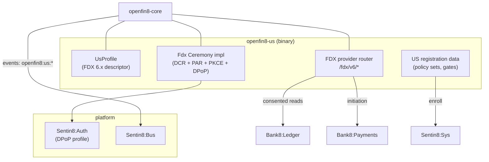

# openfin8-us - Detailed Design Document

> Status: **PROPOSED** - the FDX data-provider service for the United
> States (OBARCH-3). This is the in-place successor of `bank8-fdx`
> (design docs `bank8-fdx/DESIGN.md` remain the historical reference;
> where this document says "unchanged", the fdx behavior carries
> forward). Depends on: `openfin8-core` (OBARCH-1) for the consent
> ledger, recipient registry, CSDF, notifications, and admin
> framework. See also `bank8-open-ca` (the Canadian FDX/CDX profile of
> the same wire) and `bank8-open-uk`.

## 1. Scope & Context

**What this service is.** The US open-banking data provider
(`service_type: openfin8:us`, binary `openfin8-us`): it serves
consented account, transaction, statement, and customer data to
registered third-party data recipients over the **FDX v6.x wire**
(`/fdx/v{major}/*`), enforces consent on every request with CSDF
data minimization, and serves the recipient-side connection surfaces
used by eFinTech-style apps. It embeds `openfin8-core` and supplies
exactly three things: the FDX profile descriptor, the FDX ceremony
implementation, and the FDX provider router.

**The rename, concretely** (all shipped as one atomic change):

| Today (bank8-fdx) | After (openfin8-us) |
|---|---|
| `service_type: bank8:fdx` | `service_type: openfin8:us` |
| env prefix `BANK8_FDX_*` | `OPENFIN8_US_*` |
| schema `fdx` | schema `openfin8_us` (SQL data migration) |
| event family `fdx` → `bank8:fdx:*` | `openfin8:us:*` |
| stream family `fdx` | `open-us` |
| subdomain `bank8-fdx` | `openfin8-us` |
| telemetry property | slug `open-us` |
| Shield gates `bank8:fdx:...` | `openfin8:us:...` |

The two-ledger model, the grant-ledger seeding from
`sentin8:auth:grant:created`, the DCR-at-consent-start recipient
flow, the middleware chokepoint, and the failure modes are all
**unchanged** from `bank8-fdx/DESIGN.md` §1-§8 - those sections
remain normative for this service.

**What changes beyond the rename** (the OBARCH-2/3 deltas):

1. **Version configurability** - the six hardcoded `v6`/`"6.5"`
   strings become `OPENFIN8_US_VERSION`-driven (default `6.5`):
   route mounts (`/fdx/v{major}/...`), `validation.rs`'s route
   contract (via `profile.route_contract()`), the capability +
   certification-metrics announcements, the admin settings
   selector, and the env-init seed's `standard_version` column.
2. **Spec publication policy** - `SpecPublicationPolicy::CustomerSupplied`:
   the FDX API spec is licensed (FDX API License Agreement,
   distributed exclusively by FDX) and may never be committed.
   `docs/openapi.json` is regenerated to carry **only** bank8-owned
   routes (`/v1/recipient/*`, `/v1/auth/consent/*`, `/v1/admin/*`,
   `/v1/health`, policy surfaces). The drift-guard test flips to
   assert NO `/fdx/` paths appear in the published spec; a committed
   `specs/README.md` instructs customers to obtain the FDX API
   specification under the FDX API License from
   financialdataexchange.org and place it under gitignored
   `specs/fdx/{version}/openapi.yaml` for their recipients' use.
3. **Core extraction** - the standard-agnostic modules
   (grant ledger, recipient registry, CSDF engine, notification
   worker, admin pages, audit, Flow step profile) move to
   `openfin8-core`; this service keeps the FDX wire handlers
   (`handlers.rs` provider halves, `money_movement.rs`, `pip.rs`,
   `recurring.rs`, `payment_networks.rs`, `statement_download.rs`,
   `tax.rs`, `operations.rs`), the FDX contract table, and the FDX
   DTOs.



## 2. FDX Profile Descriptor

```rust
/// The US FDX profile - supplied to core at build_state.
pub struct UsProfile {
    /// From OPENFIN8_US_VERSION (default "6.5"); also
    /// overridable per-env via sys.services.config.
    version: String,
}

impl OpenBankingProfile for UsProfile {
    fn jurisdiction(&self) -> &'static str { "us" }
    fn standard(&self) -> StandardDescriptor {
        StandardDescriptor {
            name: "FDX",
            version: self.version.clone(),
            license: StandardLicense::CustomerSupplied,
            // FDX Core Exchange subset served by this deployment.
            families: &["ACCOUNTS", "TRANSACTIONS", "STATEMENTS",
                        "CUSTOMERS", "PAYMENTS", "TRANSFERS", "PIP"],
        }
    }
    fn provider_prefix(&self) -> String {
        format!("/fdx/v{}", major_of(&self.version))   // "/fdx/v6"
    }
    fn announced_version(&self) -> String { self.version.clone() }
    fn data_clusters(&self) -> &'static [DataClusterDef] { &FDX_CLUSTERS }
    fn scope_to_clusters(&self, scope: &str) -> Vec<DataCluster> {
        fdx_scope_map(scope)     // moves from csdf.rs unchanged
    }
    fn route_contract(&self) -> &'static [RouteDef] { &FDX_ROUTES }
    fn envelope(&self) -> EnvelopeStyle { EnvelopeStyle::Flat }  // FDX: flat JSON
    fn spec_publication(&self) -> SpecPublicationPolicy {
        SpecPublicationPolicy::CustomerSupplied
    }
}
```

`FDX_ROUTES` is today's `validation.rs` route table lifted to data -
(method, pattern, requires_body, required_fields) per route, with
the `v6` path segment templated from the configured version. The
middleware consults it through `core::contract`; nothing in core
knows the string "fdx".

## 3. FDX Ceremony (unchanged, re-homed)

DCR (RFC 7591) direct at the provider's AS with DPoP sender
constrained tokens, PAR (RFC 9126) + PKCE (RFC 7636), token
exchange with DPoP proof - the existing `tokens.rs` /
recipient-start flow. The implementation moves to the
`ConsentCeremony` impl over core's `CeremonyCtx` (auth client,
secrets resolution, pool); behavior is byte-identical to
`bank8-fdx/DESIGN.md` §4 consent flow. No JWS request signing (that
is UK/BR territory), no mTLS client cert beyond the platform's
standard workload TLS.

## 4. API Surface (unchanged families, versioned mounts)

The provider surface keeps every family from
`bank8-fdx/DESIGN.md` §4 - accounts (+ statements 302→Storage,
payment-networks + revocation), customers, consents (introspection,
revocation, lifecycle), money movement (transfers, payments, payees,
recurring), PIP, notification subscriptions + feed, discovery
(capability/availability/certification-metrics/operation-support) -
with two deltas: paths derive from `provider_prefix()`, and the
capability + certification-metrics handlers announce
`announced_version()` instead of the literal "6.5".

**Admin/RFW**: core pages + a US settings page whose version
selector lists the FDX versions this deployment supports (from
profile config), defaulting to the configured one.

## 5. Data Model

Schema `openfin8_us` (renamed from `fdx`): the 15 core tables move to
`openfin8-core` SQL (OBARCH-1 §3) parameterized by schema; the fdx
→ openfin8_us migration is a schema rename + the column generalizations
(`fdx_version` → `standard_version`). No US-specific tables are
added. The `consents.intent_payload` column stays NULL for FDX
consents (FDX has no intent document between creation and grant).

## 6. Registration & Configuration

- `service-registration.json` (vertical bank8): service_type
  `openfin8:us`, subdomain `openfin8-us`; policy sets/gates
  renamed from `bank8:fdx:*` to `openfin8:us:*`; the consent
  provider/flow entries (OAuth profile flags at Auth) unchanged in
  shape.
- `catalog.json`: binary `openfin8-us`, database env var
  `OPENFIN8_US_DATABASE_URL`.
- Env: `OPENFIN8_US_PORT`, `OPENFIN8_US_DATABASE_URL`,
  `OPENFIN8_US_BASE_URL`, `OPENFIN8_US_VERSION`,
  `OPENFIN8_US_STREAM_FAMILY` (default `open-us`), plus the
  platform-standard variables. Per-env overrides ride
  `sys.services.config` (OBARCH-1 §6 precedence).

## 7. Spec Publication (OBARCH-2)

- Published `docs/openapi.json`: bank8-owned routes only
  (utoipa-derived; the `/fdx/*` annotations move out of the
  published aggregate - they remain on the handlers, aggregated into
  a separate non-published spec struct).
- `specs/README.md` (committed) + `NOTICE` paragraph: FDX API
  specification licensing notice; customers obtain the spec from FDX
  under the FDX API License and drop it under gitignored
  `specs/fdx/{version}/`.
- Drift guard: `tests/openapi_publication.rs` asserts (a) the
  operation floor for bank8-owned routes, (b) zero `/fdx/` paths,
  (c) no FDX-derived schema names leak into components.

## 8. Failure Modes / Invariants / Testing

Carried from `bank8-fdx/DESIGN.md` §5-§9 unchanged (consent
middleware chokepoint, terminal revocation, secret references,
same-transaction discipline, no cross-tenant SQL). New: the profile
isolation invariant (OBARCH-1 §8) - the US binary mounts no UK/CA
routes by construction. Testing: the existing `bank8-e2e` recipient
journey retargets to the renamed service; unit tests for the route
contract derive from `FDX_ROUTES` data instead of inline arrays.

## 9. Open Questions

- **FDX version cadence** - FDX ships spring/fall releases (6.4
  Spring 2025, 6.5 in hand). Whether the version selector offers
  multiple majors concurrently in one deployment (mount both
  `/fdx/v6` and `/fdx/v7`?) - leaning no initially: one configured
  version per env, multi-major as a follow-up if a customer demands
  a migration window.
- **Certification metrics naming** - the FDX certification-metrics
  endpoint's wire shape stays FDX-defined; confirm the counters'
  audit-action prefixes (`data_call*`) survive the event-family
  rename without a metric discontinuity.

---

**Architecture & Design:** openfin8:us and its underlying concepts were
designed by [Hamid Jahanzad](https://www.linkedin.com/in/hamidjahanzad/).