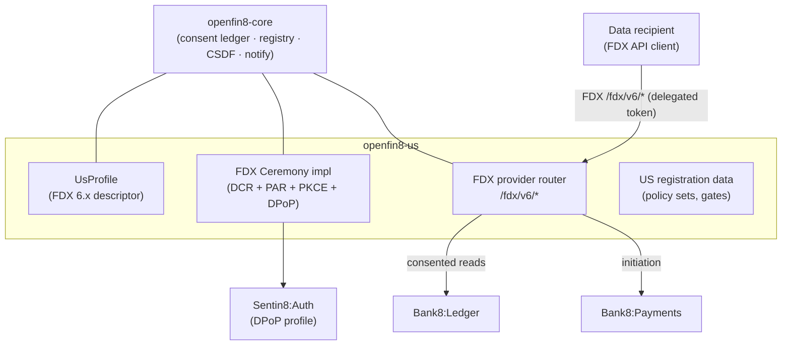

# OpenFin8:US - README

[](https://github.com/OpenFin8/openfin8-us/blob/main/LICENSE)
[](https://www.rust-lang.org/)
[](https://bank8.dev/docs/services/open-us)
[](https://bank8.dev)

US open banking (FDX v6.x): consent-managed account data sharing
between a bank (data provider) and registered third-party data
recipients - plus the money-movement read/cancel surface, event
notifications, and the hosted consent UI. The in-place successor of
OpenFin8:US.

## Summary

OpenFin8:US is a Rust service that plays the FDX **data provider**
role for the US market: it serves consented account/transaction/
statement data to registered recipients over the `/fdx/v{major}/*`
API (the major segment from the configured `OPENFIN8_US_VERSION`),
enforces consent on every request with CSDF data minimization, and
serves the recipient-side surfaces (`/v1/recipient/*`) used by
eFinTech-style apps and the platform-hosted consent RFW screens.
The provider and the recipient are independent organizations: the
recipient registers its OAuth client at the provider's authorization
server (DCR, RFC 7591), and each institution keeps its own consent
records - the bank its grant ledger, the fintech its connection
registry (the two-ledger model).

The service embeds [`openfin8-core`](https://github.com/OpenFin8/openfin8-core) - the
jurisdiction-agnostic kernel (OBARCH-1) - and supplies the US FDX
profile, the FDX ceremony (DCR + PAR + PKCE + DPoP), and the FDX
provider router. The Canadian and UK adapters
([`bank8-open-ca`](https://github.com/OpenFin8/openfin8-ca), [`bank8-open-uk`](https://github.com/OpenFin8/openfin8-uk))
follow the same contract.

## Motivation

Open banking requires that every data read is attributable to a live
consent grant with the customer in control: consents are
scope-limited, revocable, and expiring; provider tokens are
sender-constrained (DPoP + secret references); and recipients
register dynamically rather than being configured by hand. The
service centralizes the consent check, the FDX contract validation,
and the audit trail so no provider route can bypass them.

**Licensing posture**: the FDX API specification is licensed under
the FDX API License Agreement and distributed exclusively by FDX -
this repository never publishes it. The published
`docs/openapi.json` carries bank8-owned routes only, enforced by a
CI drift guard; customers supply their licensed FDX specification
under gitignored `specs/fdx/{version}/` (see
[`specs/README.md`](https://github.com/OpenFin8/openfin8-us/blob/main/specs/README.md)).

## Architecture & High-Level Design



Read [`DESIGN.md`](https://github.com/OpenFin8/openfin8-us/blob/main/DESIGN.md) (OBARCH-3) for the full design: the
rename inventory from bank8-fdx, the version-configurable route
contract, and the spec-publication policy.

## Status

**Skeleton** - the trait-shaped binary boots on the sentin8 shell
with a stub registration; the OBARCH-1 core extraction lands first,
then this service takes the extracted FDX wire handlers, the
version-parameterized mounts, and the renamed registration.

## Development

```bash
make help     # the available targets
make build    # cargo build
make test     # cargo test
make lint     # cargo fmt -- --check
make start    # infra + trimmed boot if captain is down
make status   # fleet rows for openfin8:us
make enroll   # register this repo (composable enrollment, RS §6)
```

## Contributing & License

Apache-2.0 (see [LICENSE](https://github.com/OpenFin8/openfin8-us/blob/main/LICENSE), [NOTICE](https://github.com/OpenFin8/openfin8-us/blob/main/NOTICE)). The security
model is platform-wide - read [SECURITY.md](https://github.com/OpenFin8/openfin8-us/blob/main/SECURITY.md).

---

**Architecture & Design:** openfin8:us and its underlying concepts
were designed by [Hamid Jahanzad](https://www.linkedin.com/in/hamidjahanzad/).